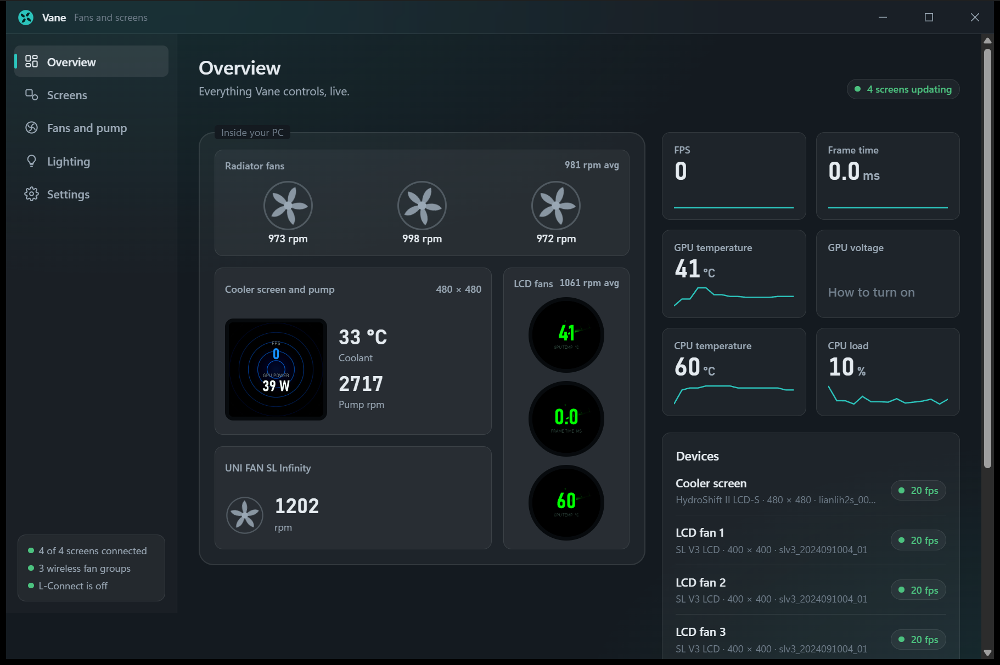
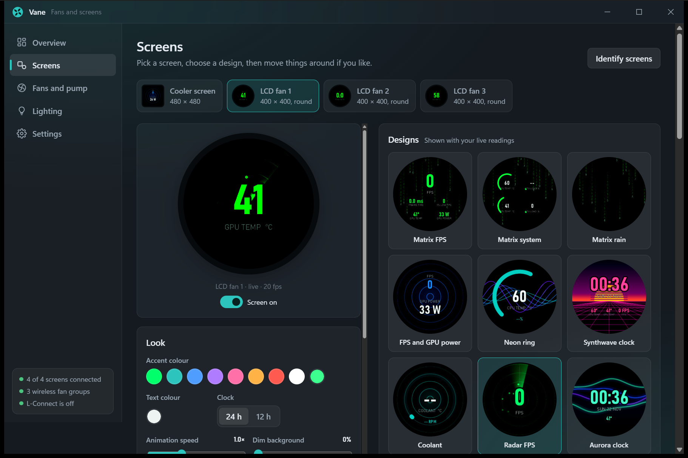

# Vane

A small Windows tray app that replaces Lian Li L-Connect 3 for these devices:

- HydroShift II LCD-S cooler screen (480 × 480)
- UNI FAN SL V3 Wireless LCD fan screens (400 × 400, round)
- Lian Li wireless fans and the HydroShift II pump, through the wireless dongle: speed and lighting

L-Connect 3 used about 480 MB of RAM on the test PC. Vane uses about 70 MB with its window open, and less in the tray.



## Download

Every release has two files on the [latest release](https://github.com/easter478/vane/releases/latest) page. They are the same app; pick one:

| File | What it is |
|---|---|
| `Vane-Setup-<version>.exe` | **Installer (recommended).** Installs Vane for your Windows account with a Start menu entry and an uninstaller. It then offers to install the free helpers Vane reads from: **MSI Afterburner** and **RivaTuner Statistics Server** (CPU temperature, FPS), and **OpenRGB** (motherboard, memory and graphics card lighting). |
| `Vane-<version>-portable.exe` | **Portable.** One exe and nothing to install: put it anywhere and run it. Install the helpers yourself if you want their readings. |

## Install

### With the installer

1. Download `Vane-Setup-<version>.exe` from the latest release and run it.
2. Windows SmartScreen may say it doesn't recognise the app, because it isn't signed by a big publisher. Click **More info**, then **Run anyway**.
3. Click through the setup. It installs for your account only, so it doesn't ask for admin.
4. When it asks, click **Yes** to install MSI Afterburner and RivaTuner, then **Yes** again for OpenRGB if you want the rest of the PC's lighting. Windows Package Manager (winget) downloads them from their publishers and skips any you already have. Windows may ask for admin for these.
5. Vane starts in the tray (the fan icon near the clock). Click it to open the window.

### Portable

1. Download `Vane-<version>-portable.exe`, put it in a folder you keep (for example `Documents\Vane`), and double-click it.
2. Get the helpers yourself if you want their readings: MSI Afterburner from msi.com (its setup includes RivaTuner) and [OpenRGB](https://openrgb.org).
3. Settings live in `%APPDATA%\Vane`, so you can move or replace the exe without losing them.

### First run: turn off L-Connect 3

Only one app can talk to the screens and fans at a time. Vane can switch L-Connect 3 off for you, and back on later:

1. Open Vane and go to **Settings**.
2. Under **L-Connect 3**, click **Turn off**. Windows asks for admin once. Vane stops L-Connect and its two services, and disables them and its startup task, so they stay off after a restart.
3. To go back to L-Connect, click **Turn back on** on the same page. Do that before uninstalling Vane if you want L-Connect back.

Vane starts with Windows by itself. Turn that off in Settings if you'd rather start it yourself.

## How to use it

### Screens

Pick a screen at the top (the cooler or one of the LCD fans). The live preview is on the left, with **Look** and **Screen** settings under it. Designs, the layout and backgrounds are on the right.

- **Designs:** click one to use it. The gallery shows each design with your live readings. Save your own with **Save as my design**.
- **Layout:** choose what each spot shows (FPS, GPU power, CPU temperature…). Click **Edit layout** to drag items on the preview, resize them, change their type (number, gauge, bar, graph, clock, date, text) and add or remove them.
- **Background:** built-in animations, a solid colour, your own picture or GIF, or a video. **Import from L-Connect** copies L-Connect's cooler videos and fan animations into Vane.
- **Look:** accent and text colour, animation speed, dim and blur the background, and what sits behind the numbers (a dark outline, a glass plate, or nothing).
- **Screen:** brightness, frames per second, rotation and colour. The LCDs look washed out with the picture as drawn, so screens start on **Vivid**. Contrast, Saturation, Depth and Deeper blacks fine-tune it. The fan screens have one backlight behind the whole panel, so black still glows a little: Deeper blacks and a lower brightness help.
- **Same look on all LCD fans** shares the design, background, look, colour, brightness and rotation across the three fan screens. Each fan keeps its own layout and readings.



### Fans and pump

Each wireless group follows a temperature on a curve you can drag, or runs at a fixed speed. **Hottest of CPU and GPU** suits case fans. HydroShift radiator fans follow the coolant temperature, which is what an AIO can actually cool. The pump stays at 30% or more. Vane re-sends lost radio commands until each fan confirms its speed.


### Lighting

Pick a group, then an effect: Static, Breathing, Rainbow, Rainbow wave, Colour cycle, Meteor, Runway, Twinkle, or Temperature (colour follows how hot the PC is). Set colours, speed, brightness and direction, and watch the preview. The fans store the effect and play it on their own.

**Rest of the PC** lights the motherboard, memory, graphics card and anything else OpenRGB supports, with the same effects. It needs OpenRGB 1.1 or later, which runs as a Windows service with its SDK server on, and Vane connects to it by itself. Each device has its own switch. Keyboards, mice and things like a Stream Deck stay off unless you switch them on, so their own lighting or key icons aren't painted over.

Vane also shares the fans the other way: in OpenRGB's **SDK Client** tab, connect to `127.0.0.1` port `6743` and the fans and pump appear as OpenRGB devices.


### Readings

| Source | Readings |
|---|---|
| RivaTuner Statistics Server | FPS, frame time, 1% low |
| MSI Afterburner | CPU temperature, CPU power and clock (and GPU voltage, if you tick **Unlock voltage monitoring** in Afterburner's settings and **Voltage** on its Monitoring tab) |
| NVIDIA driver | GPU temperature, power in watts, load, clocks, VRAM, fan |
| Windows | CPU load, RAM |
| HydroShift II | coolant temperature, pump speed |
| HWiNFO (optional) | anything you tick "Report value in Gadget" on |

Windows only hands CPU temperature to programs with a hardware driver, which is why it comes from Afterburner. Vane starts Afterburner and RivaTuner again if they were closed, using their own start-with-Windows tasks. Settings shows which sources are working and how to turn on any reading that's missing.


## Uninstall

1. In Vane's **Settings**, click **Turn back on** under L-Connect 3 if you want L-Connect back.
2. Quit Vane from its tray icon.
3. Installer version: Windows **Settings → Apps → Installed apps → Vane → Uninstall**. Portable: delete the exe.
4. To remove your settings too, delete `%APPDATA%\Vane`.

## Requirements

- Windows 10 or 11 with WebView2 (built in on Windows 11; the installer adds it if it's missing).
- The devices on the Microsoft WinUSB driver, which L-Connect 3 already installs.
- Optional helpers: MSI Afterburner and RivaTuner (CPU temperature, FPS), OpenRGB (the rest of the PC's lighting).

## Build

Vane is Rust and Tauri 2, and it builds on Windows with the MSVC toolchain. The tinyuz compressor that the fans' lighting needs is vendored C++, built by `build.rs`.

```bash
cd src-tauri
cargo build --release
```

That gives the portable exe at `src-tauri/target/release/vane.exe`. For the installer (every release ships both), install the Tauri CLI once (`cargo install tauri-cli --version 2.9.4 --locked`), then run `cargo tauri build`. The installer lands in `src-tauri/target/release/bundle/nsis/`.

`tools/deploy.sh` builds and installs Vane on a Windows PC over SSH from a Mac or Linux machine. Put `VANE_PC=user@host` in `tools/pc.env` first.

## How it works

| Part | File |
|---|---|
| LCD drivers (DES-CBC command headers, JPEG frames) | `src-tauri/src/usb.rs` |
| Wireless dongle: device list, fan PWM, lighting upload, motherboard-sync off | `src-tauri/src/wireless.rs` |
| Lighting effects | `src-tauri/src/lighting.rs` |
| OpenRGB SDK server (fans to OpenRGB) | `src-tauri/src/openrgb.rs` |
| OpenRGB client (motherboard, memory, GPU) | `src-tauri/src/openrgb_client.rs` |
| tinyuz compressor binding | `src-tauri/src/tinyuz.rs`, `src-tauri/vendor/` |
| Video backgrounds (Media Foundation) | `src-tauri/src/video.rs` |
| L-Connect video import | `src-tauri/src/library.rs` |
| Sensor hub: RTSS, MSI Afterburner, NVIDIA (NVML), HWiNFO, Windows | `src-tauri/src/sensors.rs` |
| Screen renderer and widgets (tiny-skia, ab_glyph) | `src-tauri/src/render.rs` |
| Settings and built-in designs | `src-tauri/src/config.rs` |
| Worker threads | `src-tauri/src/engine.rs` |
| Installer hooks (Afterburner, RTSS and OpenRGB via winget) | `src-tauri/windows/hooks.nsh` |
| Window UI | `ui/` |

Settings are saved in `%APPDATA%\Vane\config.json`. In the same folder, `lighting.log`, `wireless.txt`, `screens.log` and `openrgb.log` help trace lighting, radio, screen and OpenRGB problems.

## Credits

Device protocol details come from [lian-li-linux](https://github.com/sgtaziz/lian-li-linux) by sgtaziz (MIT). The [tinyuz](https://github.com/sisong/tinyuz) and [HDiffPatch](https://github.com/sisong/HDiffPatch) sources in `src-tauri/vendor` are MIT, by housisong. Vane is not affiliated with Lian Li.

## License

MIT
