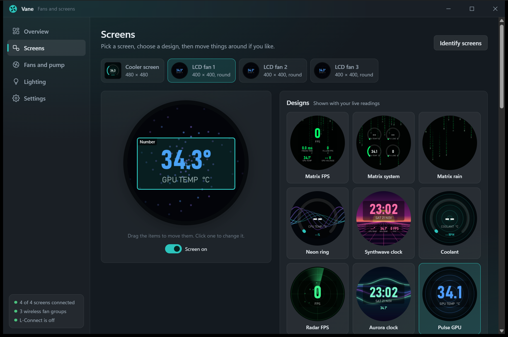
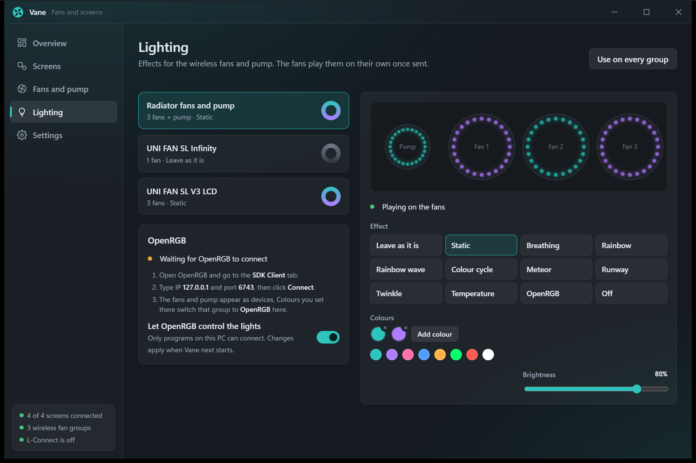
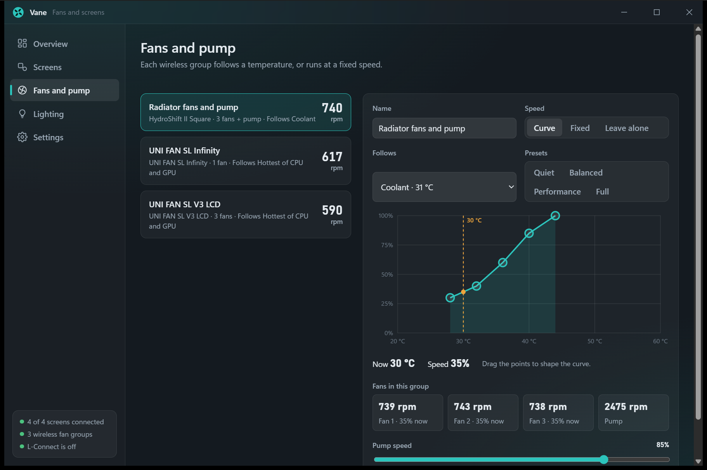
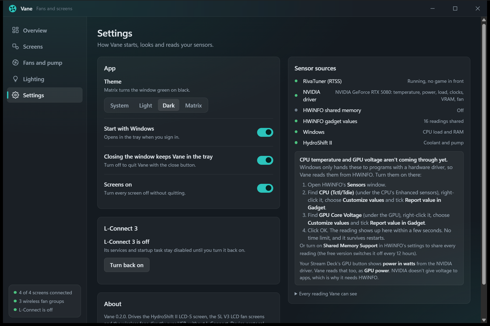

# Vane

A small Windows tray app that replaces Lian Li L-Connect 3 for these devices:

- HydroShift II LCD-S cooler screen (480 × 480)
- UNI FAN SL V3 Wireless LCD fan screens (400 × 400, round)
- Lian Li wireless fans and the HydroShift II pump, through the wireless dongle: speed and lighting

L-Connect 3 used about 480 MB of RAM on the test PC. Vane uses about 70 MB with its window open, and less in the tray.


## Download

Get either file from the [latest release](https://github.com/easter478/vane/releases/latest):

| File | What it is |
|---|---|
| `Vane-Setup-0.2.0.exe` | **Installer.** Installs Vane for your Windows account with a Start menu entry and an uninstaller. It then offers to install **HWiNFO** and **RivaTuner Statistics Server** through Windows Package Manager (winget), skipping any you already have. |
| `Vane-0.2.0-portable.exe` | **Portable.** One exe, nothing to install: put it anywhere and run it. Settings live in `%APPDATA%\Vane`. It adds itself to Windows startup unless you turn that off in Settings. |

Both builds are the same app. Quit L-Connect 3 first, or let Vane turn it off from its Settings page. Only one app can talk to the devices at a time.

## What it does

- **Designs:** ready-made screen designs, previewed in the gallery with your live readings before you pick one. Save your own as "my designs".
- **Layout editor:** click Edit layout, then drag items on the preview to move them. Change what each item shows, its type (number, gauge, bar, graph, clock, date, text), size and colour, and add or remove items.
- **Backgrounds:** Matrix rain, aurora, nebula, synthwave, neon waves, pulse rings, radar, particles, carbon, a solid colour, your own picture or GIF, or a video (MP4, AVI, WMV…).
- **Import from L-Connect:** copies L-Connect 3's cooler theme videos and SL V3 fan animations into Vane, so they keep working after L-Connect is uninstalled.
- **Fans and pump:** each wireless group follows a temperature on an editable curve, or runs at a fixed speed. A "Hottest of CPU and GPU" reading suits case fans. HydroShift radiator fans follow the coolant. The pump stays at 30% or more. Lost radio commands are resent until the fan confirms them.
- **Lighting:** Static, Breathing, Rainbow, Rainbow wave, Colour cycle, Meteor, Runway, Twinkle, and Temperature (colour follows how hot the PC is). Each effect has colours, speed, brightness and direction, plus a live preview. Effects are uploaded once and the fans play them on their own.
- **OpenRGB:** Vane runs an OpenRGB SDK server on `127.0.0.1:6743`. In OpenRGB, open the **SDK Client** tab, connect to that address, and the fans and pump appear as devices with per-LED colour.
- **Readings:**
  - FPS, frame time and 1% low from RivaTuner;
  - GPU temperature, power, load, clocks, VRAM and fan straight from the NVIDIA driver;
  - CPU temperature, GPU voltage and everything else from HWiNFO;
  - CPU load and RAM from Windows;
  - coolant temperature and pump speed from the cooler.
- **App:** lives in the tray, starts with Windows, and has System, Light, Dark and Matrix themes. It can turn L-Connect 3 off and back on.







## Requirements

- Windows 10 or 11 with WebView2 (built in on Windows 11; the installer adds it if it's missing).
- The devices on the Microsoft WinUSB driver, which L-Connect 3 already installs.
- **RivaTuner Statistics Server** for FPS and frame time.
- **HWiNFO** for CPU temperature and GPU voltage. Windows only gives these to programs with a hardware driver. In HWiNFO's Sensors window, right-click **CPU (Tctl/Tdie)** and **GPU Core Voltage** → Customize values → tick **Report value in Gadget**. Or turn on Shared Memory Support to share every reading. Vane's Settings page shows which readings are missing and how to turn them on.



## Build

Vane is Rust and Tauri 2, and it builds on Windows with the MSVC toolchain. The tinyuz compressor that the fans' lighting needs is vendored C++, built by `build.rs`.

```bash
cd src-tauri
cargo build --release
```

That gives the portable exe at `src-tauri/target/release/vane.exe`. For the installer, install the Tauri CLI once (`cargo install tauri-cli --version 2.9.4 --locked`), then run `cargo tauri build`. The installer lands in `src-tauri/target/release/bundle/nsis/`.

`tools/deploy.sh` builds and installs Vane on a Windows PC over SSH from a Mac or Linux machine. Put `VANE_PC=user@host` in `tools/pc.env` first.

## How it works

| Part | File |
|---|---|
| LCD drivers (DES-CBC command headers, JPEG frames) | `src-tauri/src/usb.rs` |
| Wireless dongle: device list, fan PWM, lighting upload, motherboard-sync off | `src-tauri/src/wireless.rs` |
| Lighting effects | `src-tauri/src/lighting.rs` |
| OpenRGB SDK server | `src-tauri/src/openrgb.rs` |
| tinyuz compressor binding | `src-tauri/src/tinyuz.rs`, `src-tauri/vendor/` |
| Video backgrounds (Media Foundation) | `src-tauri/src/video.rs` |
| L-Connect video import | `src-tauri/src/library.rs` |
| Sensor hub: RTSS, NVIDIA (NVML), HWiNFO, Windows | `src-tauri/src/sensors.rs` |
| Screen renderer and widgets (tiny-skia, ab_glyph) | `src-tauri/src/render.rs` |
| Settings and built-in designs | `src-tauri/src/config.rs` |
| Worker threads | `src-tauri/src/engine.rs` |
| Installer hooks (HWiNFO and RTSS via winget) | `src-tauri/windows/hooks.nsh` |
| Window UI | `ui/` |

Settings are saved in `%APPDATA%\Vane\config.json`. `lighting.log` and `wireless.txt` in the same folder help trace lighting and radio problems.

## Credits

Device protocol details come from [lian-li-linux](https://github.com/sgtaziz/lian-li-linux) by sgtaziz (MIT). The [tinyuz](https://github.com/sisong/tinyuz) and [HDiffPatch](https://github.com/sisong/HDiffPatch) sources in `src-tauri/vendor` are MIT, by housisong. Vane is not affiliated with Lian Li.

## License

MIT
