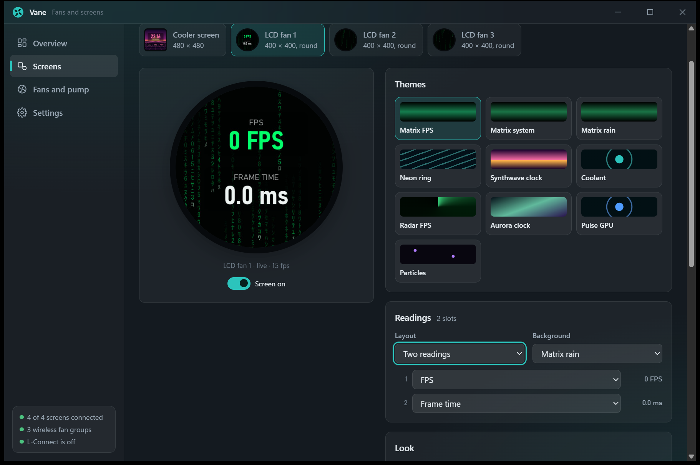

# Vane

A small Windows tray app that replaces Lian Li L-Connect 3 for these devices:

- HydroShift II LCD-S cooler screen (480 × 480)
- UNI FAN SL V3 Wireless LCD fan screens (400 × 400, round)
- Lian Li wireless fans and the HydroShift II pump, through the wireless dongle

L-Connect 3 used about 480 MB of RAM on the test PC. Vane uses about 70 MB with its window open, and less in the tray.


## What it does

- **Screens:** sensor readings drawn over animated backgrounds: Matrix rain, aurora, nebula, synthwave, neon waves, pulse rings, radar, particles, carbon, a solid colour, or your own picture or GIF.
- **Layouts:** gaming (FPS plus 4 readings), system gauges, ring gauge, big number, two readings, bars, clock, and clock plus readings.
- **Readings:**
  - FPS, frame time and 1% low from RivaTuner;
  - CPU and GPU temperatures, loads, clocks, power and GPU voltage from HWiNFO;
  - CPU load and RAM from Windows;
  - coolant temperature and pump speed from the cooler.
- **Fans and pump:** each wireless group follows a temperature on an editable curve, or runs at a fixed speed. The pump stays at 30% or more.
- **App:** lives in the tray, starts with Windows, and has System, Light, Dark and Matrix themes. It can turn L-Connect 3 off and back on.



## Requirements

- Windows 10 or 11 with WebView2 (built in on Windows 11).
- The devices on the Microsoft WinUSB driver, which L-Connect 3 already installs.
- L-Connect 3 turned off. Only one app can talk to the devices at a time, and Vane's Settings page has a switch for it.
- **RivaTuner Statistics Server** for FPS and frame time.
- **HWiNFO** for CPU temperature, GPU voltage and other hardware readings. Turn on Settings → Shared Memory Support. Or, for each reading you want, right-click it → Customize values → Report value in Gadget.

## Build

Vane is Rust and Tauri 2, and it builds on Windows with the MSVC toolchain:

```bash
cd src-tauri
cargo build --release
```

The exe is `src-tauri/target/release/vane.exe`. `tools/deploy.sh` builds and installs Vane on a Windows PC over SSH from a Mac or Linux machine. Put `VANE_PC=user@host` in `tools/pc.env` first.

## How it works

| Part | File |
|---|---|
| LCD drivers (DES-CBC command headers, JPEG frames) | `src-tauri/src/usb.rs` |
| Wireless dongle: device list, fan PWM | `src-tauri/src/wireless.rs` |
| Sensor hub: RTSS, HWiNFO, Windows | `src-tauri/src/sensors.rs` |
| Screen renderer (tiny-skia, ab_glyph) | `src-tauri/src/render.rs` |
| Settings and built-in themes | `src-tauri/src/config.rs` |
| Worker threads | `src-tauri/src/engine.rs` |
| Window UI | `ui/` |

Settings are saved in `%APPDATA%\Vane\config.json`.

## Status

Version 0.1. Lighting effects and video backgrounds aren't in yet.

## Credits

Device protocol details come from [lian-li-linux](https://github.com/sgtaziz/lian-li-linux) by sgtaziz (MIT). Vane is not affiliated with Lian Li.

## License

MIT
